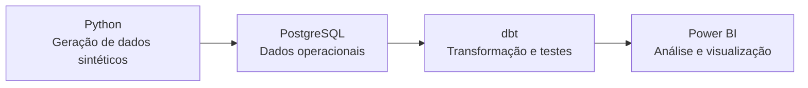

# AT-orders — Analyzing and Tracking Orders

## Visão geral

I created AT-orders to analyze the e-commerce order journey, from creation to delivery. I generated synthetic data with Python, simulating information that could come from systems such as ERP, CRM, WMS, and TMS. I stored the data in PostgreSQL and used dbt to transform it into analytical models, document tests, and validate data quality.

In Power BI, I built two pages: Executive Overview, to monitor the overall flow, and Control Tower, to investigate orders that need attention.

## Contexto e perguntas de negócio

In a sales operation, tracking an order involves several stages and pieces of operational information. A consolidated flow view can help show where orders are and which situations need follow-up.

The project explores questions such as:

- How many orders are in each stage, have been completed, or have been canceled?
- How long did completed orders spend in each stage?
- How long have active orders been in their current stage?
- Which stages or orders show warning signs or are delayed?
- Which orders need to be investigated by the operations team?

Since the data is synthetic, the results represent a simulated scenario.

## Páginas do Power BI

### Executive Overview

Presents a consolidated view of the order flow, with indicators and volumes by stage.


### Control Tower

Lets you monitor the stages and look up orders in detail, with filters and operational indicators.


## Architecture




## Analytical model

The lineage diagrams below show which dbt models feed each reporting table used in Power BI. The data moves through the staging, intermediate, and marts layers before being made available for analysis and for building the product.

### Mart_Control_Tower


### Mart_Execuitve_Order_Flow


## Modeling and data quality

The dbt transformations are organized in layers. In staging, source data is standardized; in intermediate, it is combined to represent the rules and stages of the order journey; in marts, it is prepared for analysis in Power BI.

Fact and dimension tables have a defined granularity for each analysis. For example, fct_order_stage has one row per order and stage, while mart_executive_order_flow summarizes indicators by stage. The reporting models feed the Executive Overview and Control Tower pages.

### Quality tests
The tests check aspects such as missing values, duplicates, accepted categories, and relationships between tables. SQL tests were also created to verify business rules, such as reconciliations and granularity consistency.

### Technical documentation
Model and column descriptions, along with some of the tests, are defined in the dbt YAML files. The lineage generated by dbt shows which models and sources contribute to each final table. This README summarizes the architecture; the product documentation details how to use the Power BI pages.

## Technologies

- Docker Compose
- SQL
- Git
- Python: synthetic data generation.
  - psycopg: connects the scripts to PostgreSQL.
  - dbt-postgres: dbt with the PostgreSQL adapter.
  - pytest e Ruff: testing and linting of the Python code.
- PostgreSQL
- dbt Core
- Power BI


## How to run

### Prerequisites

- Python 3.12 ou superior
- Git
- Docker Desktop

### Installation and setup

Clone the repository and, in the project folder, run:

```cmd
python -m venv .venv
.venv\Scripts\activate
python -m pip install -e ".[dev]"
copy .env.example .env
```

Fill in the .env file with your local settings.

### Database

Start PostgreSQL and test the connection:

```cmd
docker compose up -d postgres
python scripts\check_connection.py
```

### Data generation

Run the scripts from the project root, in this order:

```cmd
python scripts\generate_reference_data.py
python scripts\generate_customers.py
python scripts\generate_products.py
python scripts\generate_orders.py
python scripts\generate_fulfillment.py
```

### Modeling with dbt

Before running dbt, configure the local profile in ~/.dbt/profiles.yml. The profile used by the project is atorders_analytics, with the dev target.

```cmd
cd dbt\atorders_analytics
dbt debug
dbt build
```

dbt debug checks the database connection. dbt build runs the project's models and tests.

## Repository structure

```text
.
├── dbt/
│   └── atorders_analytics/
├── docs/
│   ├── images/
│   └── power-bi.md
├── infra/
├── scripts/
├── src/
│   └── atorders/
├── tests/
├── .env.example
├── docker-compose.yml
├── pyproject.toml
├── README.md
└── README.pt-BR.md
```

## Next steps

- Create Power BI pages to deepen the analysis of Payments and Deliveries.
- Automate project checks with GitHub Actions, including linting, Python tests, and dbt tests.