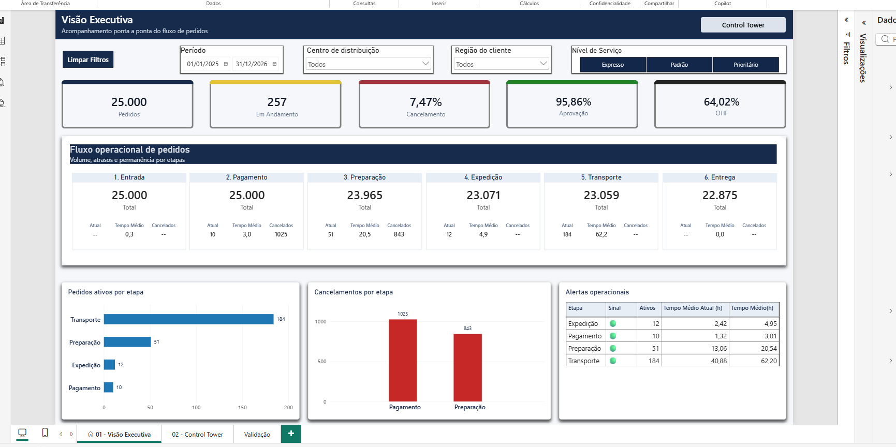
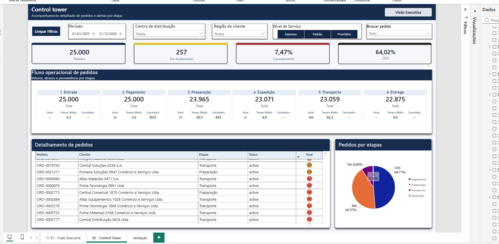
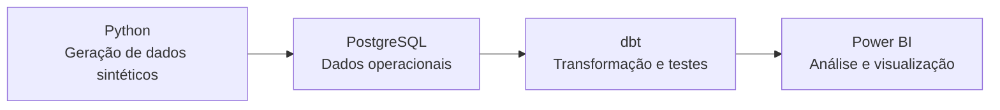
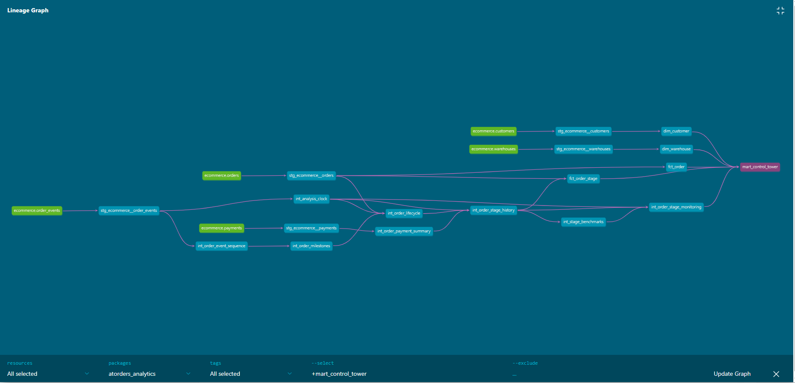
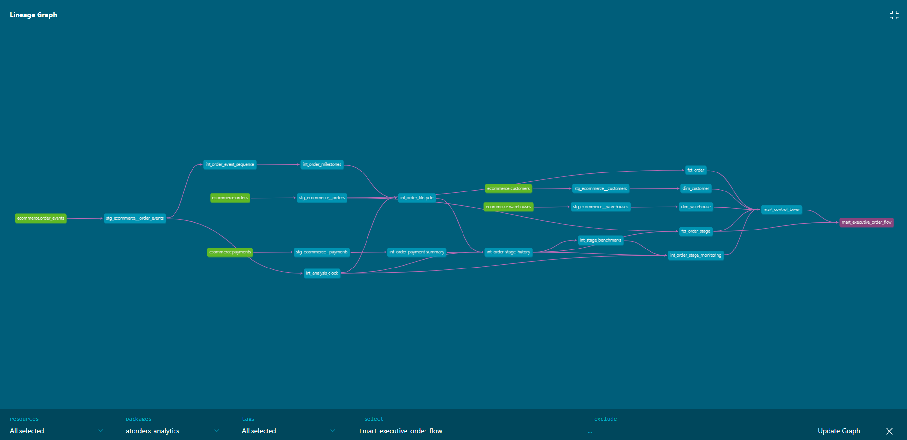

# AT-orders — Analyzing and Tracking Orders

## Visão geral

Criei o **AT-orders** para analisar a jornada de pedidos de e-commerce, da criação à entrega. Gerei dados sintéticos com Python, simulando informações que poderiam vir de sistemas como ERP, CRM, WMS e TMS. Armazenei os dados no PostgreSQL e usei o dbt para transformá-los em modelos analíticos, documentar os testes e validar a qualidade dos dados.

No Power BI, desenvolvi duas páginas: **Visão Executiva**, para acompanhar o fluxo geral, e **Control Tower**, para investigar pedidos que precisam de atenção.

## Contexto e perguntas do projeto

Em uma operação de vendas, acompanhar um pedido envolve diferentes etapas e informações operacionais. Uma visão consolidada em fluxo pode ajudar a entender onde estão os pedidos e quais situações precisam de acompanhamento.

O projeto explora perguntas como:

- Quantos pedidos estão em cada etapa, foram concluídos ou foram cancelados?
- Quanto tempo os pedidos concluídos levaram em cada etapa?
- Há quanto tempo os pedidos ativos permanecem na etapa atual?
- Quais etapas ou pedidos apresentam sinais de atenção ou estão atrasados?
- Quais pedidos precisam ser investigados pela operação?

Como os dados são sintéticos, os resultados representam um cenário simulado.

## Páginas do Power BI

### Visão Executiva

Apresenta uma visão consolidada do fluxo de pedidos, com indicadores e volumes por etapa.



### Control Tower

Permite acompanhar as etapas e consultar os pedidos em detalhe, com filtros e indicadores operacionais.



## Arquitetura




## Modelo analítico

As linhagens (diagramas) abaixo mostram quais modelos do dbt alimentam cada tabela de reporting usada no Power BI, os dados passam pelas camadas **staging**, **intermediate** e **marts** até serem disponibilizados para análise e construção do produto.

### Mart_Control_Tower



### Mart_Execuitve_Order_Flow



## Modelagem e qualidade dos dados

As transformações no dbt foram organizadas em camadas.
Em `staging`, os dados das fontes são padronizados;
em `intermediate`, são combinados para representar regras e etapas da jornada dos pedidos;
em `marts`, são preparados para análise no Power BI.

As tabelas fato e dimensão têm granularidades definidas para cada análise. Por exemplo, `fct_order_stage` tem uma linha por pedido e etapa, enquanto `mart_executive_order_flow` resume os indicadores por etapa.
Os modelos de reporting alimentam as páginas **Visão Executiva** e **Control Tower**.

### Testes de qualidade
Os testes verificam aspectos como valores ausentes, duplicidades, categorias permitidas e relacionamentos entre tabelas. Também foram criados testes em SQL para conferir regras aplicadas ao fluxo, como reconciliações e consistência da granularidade.

### Documentação técnica
As descrições dos modelos e das colunas, junto com parte dos testes, estão nos arquivos YAML do dbt. A linhagem gerada pelo dbt mostra quais modelos e fontes contribuem para cada tabela final. O README resume essa arquitetura; a documentação do produto detalha o uso das páginas do Power BI.

## Tecnologias

- Docker Compose
- SQL
- Git
- Python: geração dos dados sintéticos.
  - psycopg: conexão dos scripts com o PostgreSQL.
  - dbt-postgres: dbt com o adaptador para PostgreSQL.
  - pytest e Ruff: testes e verificação do código Python.
- PostgreSQL
- dbt Core
- Power BI


## Como executar

### Pré-requisitos

- Python 3.12 ou superior
- Git
- Docker Desktop

### Instalação e configuração

Clone o repositório e, na pasta do projeto, execute:

```cmd
python -m venv .venv
.venv\Scripts\activate
python -m pip install -e ".[dev]"
copy .env.example .env
```

Preencha o `.env` com as configurações locais.

### Banco de dados

Inicie o PostgreSQL e teste a conexão:

```cmd
docker compose up -d postgres
python scripts\check_connection.py
```

### Geração dos dados

Execute os scripts na raiz do projeto e nesta ordem:

```cmd
python scripts\generate_reference_data.py
python scripts\generate_customers.py
python scripts\generate_products.py
python scripts\generate_orders.py
python scripts\generate_fulfillment.py
```

### Modelagem com dbt

Antes de executar o dbt, configure o perfil local em `~/.dbt/profiles.yml`. O perfil usado pelo projeto é `atorders_analytics`, com alvo `dev`.

```cmd
cd dbt\atorders_analytics
dbt debug
dbt build
```

`dbt debug` verifica a conexão com o banco. `dbt build` executa os modelos e testes do projeto.

## Estrutura do repositório

```text
.
├── dbt/
│   └── atorders_analytics/
├── docs/
│   ├── images/
│   └── power-bi.md
├── infra/
├── scripts/
├── src/
│   └── atorders/
├── tests/
├── .env.example
├── docker-compose.yml
├── pyproject.toml
├── README.md
└── README.pt-BR.md
```

## Próximas evoluções

- Criar páginas no Power BI para aprofundar as análises de Pagamentos e Entregas.
- Automatizar verificações do projeto com GitHub Actions, incluindo lint, testes Python e testes dbt.