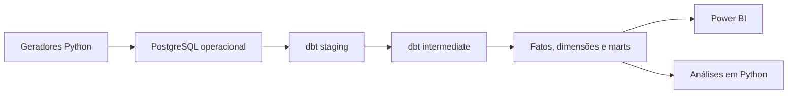

# ATOrders

> Order Analytics & Tracking

Projeto de Analytics Engineering para acompanhar o ciclo de vida de pedidos, identificar gargalos operacionais, medir níveis de serviço e priorizar pedidos que exigem intervenção.

> Status: planejamento e definição do domínio.

## Contexto

O ATOrders representa o ambiente analítico de uma distribuidora B2B fictícia com múltiplos centros de distribuição, clientes em diferentes regiões e pedidos atendidos por diferentes transportadoras.

O processo operacional envolve criação do pedido, aprovação do pagamento, alocação, separação, embalagem, expedição, transporte e entrega.

Embora esses dados existam nos sistemas operacionais, sua fragmentação dificulta responder perguntas importantes:

- Em qual etapa os pedidos estão acumulando?
- Quais etapas aumentam o tempo total do processo?
- Quais pedidos estão parados ou próximos de violar o SLA?
- Quais centros de distribuição apresentam maior tempo de ciclo?
- Quais transportadoras concentram atrasos?
- O pedido foi entregue no prazo e de forma completa?
- Quais exceções devem ser tratadas primeiro?

## Pergunta central

> Como transformar o histórico operacional dos pedidos em uma visão confiável do fluxo, localizar gargalos e priorizar ações que melhorem prazo, produtividade e nível de serviço?

## Objetivo

Construir um produto analítico capaz de:

- reconstruir a jornada de cada pedido;
- medir o tempo gasto em cada etapa;
- acompanhar backlog, aging e throughput;
- avaliar o cumprimento dos SLAs;
- calcular entregas On Time In Full — OTIF;
- identificar pedidos parados ou em risco;
- apoiar análises de gargalos e atrasos;
- oferecer rastreabilidade entre indicadores e pedidos.

## Usuários do produto

| Usuário | Pergunta principal | Decisão apoiada |
|---|---|---|
| Diretor de Operações | Onde o fluxo está piorando? | Priorizar melhorias e capacidade |
| Gerente de Logística | Quais pedidos e transportadoras exigem atenção? | Atuar sobre atrasos e exceções |
| Líder de Armazém | Em qual etapa existe acúmulo? | Redistribuir esforço operacional |
| Atendimento | Qual é a situação real do pedido? | Responder ao cliente com rastreabilidade |
| Analista de Dados | As métricas são consistentes? | Validar regras e investigar anomalias |

## Decisões apoiadas

O produto deverá ajudar as áreas responsáveis a:

- priorizar pedidos próximos do vencimento do SLA;
- identificar etapas com acúmulo de trabalho;
- investigar centros de distribuição com maior tempo de ciclo;
- comparar o desempenho das transportadoras;
- localizar pedidos parados ou com eventos ausentes;
- avaliar atrasos por região, depósito e transportadora;
- acompanhar entregas completas e dentro do prazo;
- separar variações normais de exceções que exigem ação.

## Ciclo do pedido


Cancelamentos e tentativas de entrega serão tratados como ramificações do fluxo principal.

## Escopo do MVP

A primeira versão deverá:

1. gerar dados operacionais sintéticos e reproduzíveis;
2. armazenar as fontes em PostgreSQL;
3. padronizar e testar as fontes com dbt;
4. reconstruir a sequência de eventos de cada pedido;
5. calcular os marcos e tempos do ciclo;
6. modelar dimensões, fatos e marts analíticos;
7. calcular backlog, aging, throughput, SLA e OTIF;
8. identificar pedidos parados ou em risco por regras explicáveis;
9. construir uma Control Tower no Power BI;
10. permitir detalhamento até o pedido;
11. reconciliar os indicadores do dashboard com os marts;
12. produzir dois estudos analíticos com recomendações e limitações.

## Produto analítico inicial

O dashboard do MVP terá quatro páginas:

1. **Visão executiva** — volume, lead time, SLA e OTIF;
2. **Fluxo operacional** — backlog, aging e gargalos por etapa;
3. **Desempenho logístico** — prazos, depósitos e transportadoras;
4. **Jornada do pedido** — eventos, tempos e exceções de um pedido específico.

Também será criada uma fila de pedidos em risco, com:

- nível de severidade;
- etapa atual;
- tempo parado;
- limite de SLA;
- motivo do risco;
- ação sugerida.

## Métricas principais

| Métrica | Objetivo |
|---|---|
| Backlog | Quantificar pedidos ainda não concluídos |
| Aging | Medir há quanto tempo o pedido permanece aberto ou parado |
| Throughput | Medir quantos pedidos são processados em determinado período |
| Lead time | Medir o tempo total ou por etapa |
| SLA compliance | Avaliar o cumprimento dos limites operacionais |
| On-time | Identificar pedidos entregues até a data prometida |
| In-full | Identificar pedidos entregues integralmente |
| OTIF | Medir pedidos entregues simultaneamente no prazo e completos |

As definições completas, regras de elegibilidade e fórmulas serão registradas no catálogo de métricas.

## Estudos analíticos do MVP

### 1. Gargalos do fluxo

Identificar quais etapas, períodos ou centros de distribuição concentram maior backlog e tempo de processamento.

### 2. Atrasos de entrega

Analisar como depósito, região, transportadora e tempo das etapas estão associados aos pedidos entregues com atraso.

Os estudos apresentarão observações, recomendações, limitações e distinção entre associação e causalidade.

## Arquitetura planejada



O PostgreSQL será utilizado com separação lógica por schemas:

| Schema | Responsabilidade |
|---|---|
| `ecommerce` | Fontes operacionais sintéticas |
| `analytics_staging` | Limpeza e padronização |
| `analytics_intermediate` | Regras e transformações reutilizáveis |
| `analytics_marts` | Fatos, dimensões e produtos de consumo |

## Tecnologias planejadas

- PostgreSQL;
- SQL;
- dbt Core;
- Python;
- Pandas;
- Jupyter;
- Power BI;
- Docker;
- Git e GitHub;
- GitHub Actions.

## Fora do escopo do MVP

Para manter o projeto alinhado a Analytics Engineering, Data Analysis e BI, o MVP não incluirá:

- arquitetura Bronze, Silver e Gold;
- data lake ou lakehouse;
- Spark ou PySpark;
- Airflow;
- Kafka, SQS ou streaming;
- LocalStack;
- Terraform;
- implementação em cloud;
- machine learning para previsão de atrasos;
- otimização de rotas;
- geolocalização em tempo real;
- análise avançada de estoque;
- análise de devoluções.

Estoque, atendimento parcial e devoluções poderão ser adicionados em versões posteriores.

## Critérios de sucesso

O MVP será considerado concluído quando:

- os dados sintéticos puderem ser reproduzidos por uma seed;
- outra pessoa conseguir executar o projeto seguindo o README;
- o `dbt build` for concluído sem erros;
- todos os modelos declararem seu grão;
- a jornada dos pedidos for reconstruída corretamente;
- SLA e OTIF possuírem definições documentadas;
- fatos, dimensões e marts estiverem testados;
- o Power BI reconciliar seus resultados com os marts;
- cada pedido em risco apresentar uma justificativa;
- os dois estudos analíticos apresentarem recomendações e limitações;
- arquitetura, métricas e regras de negócio estiverem documentadas.

## Roadmap

- [ ] Definir domínio, fontes e regras de negócio
- [ ] Criar catálogo inicial de métricas
- [ ] Preparar PostgreSQL e Docker
- [ ] Gerar dados operacionais sintéticos
- [ ] Criar projeto dbt
- [ ] Implementar staging
- [ ] Reconstruir o ciclo de vida dos pedidos
- [ ] Criar fatos, dimensões e marts
- [ ] Desenvolver a fila de pedidos em risco
- [ ] Construir o Power BI
- [ ] Realizar os estudos analíticos
- [ ] Implementar testes, documentação e CI

## Estrutura inicial

```text
ATOrders/
├── docs/
│   ├── architecture/
│   ├── business/
│   └── metrics/
├── src/
├── tests/
├── .gitignore
└── README.md

```

A estrutura será ampliada conforme os componentes forem implementados.