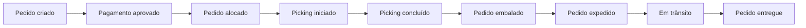

# Regras de negócio

## Objetivo

Este documento define as regras do domínio operacional do ATOrders. Ele será a referência para geração dos dados, transformação no dbt, testes, métricas e dashboards.

## Contexto operacional

O ATOrders representa uma distribuidora B2B fictícia que recebe pedidos de clientes e realiza seu atendimento por meio de diferentes centros de distribuição e transportadoras.

Um pedido pode possuir vários itens, mas deve manter um único identificador durante toda a jornada.

## Entidades principais

| Entidade | Descrição |
|---|---|
| Cliente | Empresa que realiza o pedido |
| Produto | Item comercializado |
| Centro de distribuição | Local responsável pelo atendimento |
| Transportadora | Empresa responsável pelo transporte |
| Pedido | Solicitação comercial do cliente |
| Item do pedido | Produto e quantidade solicitados |
| Pagamento | Situação financeira do pedido |
| Remessa | Expedição associada ao pedido |
| Item da remessa | Quantidade de cada item enviada |
| Evento | Mudança registrada durante a jornada |

## Fontes operacionais planejadas

O schema `ecommerce` deverá conter:

- `customers`;
- `products`;
- `warehouses`;
- `carriers`;
- `orders`;
- `order_items`;
- `payments`;
- `shipments`;
- `shipment_items`;
- `order_events`.

A tabela `shipment_items` será necessária para comparar as quantidades pedidas e entregues no cálculo de atendimento completo.

## Jornada principal



## Eventos do ciclo

| Evento | Significado |
|---|---|
| `order_created` | Pedido registrado |
| `payment_approved` | Pagamento autorizado |
| `order_allocated` | Pedido atribuído a um centro de distribuição |
| `picking_started` | Separação iniciada |
| `picking_completed` | Separação concluída |
| `order_packed` | Embalagem concluída |
| `order_shipped` | Pedido entregue à transportadora |
| `in_transit` | Transporte iniciado |
| `delivery_attempted` | Tentativa de entrega realizada |
| `order_delivered` | Entrega confirmada |
| `order_cancelled` | Pedido cancelado |

## Status analítico

| Status | Evento de referência |
|---|---|
| `created` | `order_created` |
| `paid` | `payment_approved` |
| `allocated` | `order_allocated` |
| `picking` | `picking_started` |
| `picked` | `picking_completed` |
| `packed` | `order_packed` |
| `shipped` | `order_shipped` |
| `in_transit` | `in_transit` |
| `delivered` | `order_delivered` |
| `cancelled` | `order_cancelled` |

O status analítico será derivado dos eventos válidos. O status presente em `orders` será utilizado para reconciliação.

## Regras do pedido

1. Todo pedido deve possuir um `order_id` único.
2. Todo pedido deve possuir pelo menos um item.
3. Todo item deve estar associado a um produto existente.
4. Todo pedido deve estar associado a um cliente existente.
5. O valor total deve corresponder à soma dos itens, descontos, frete e impostos.
6. A data prometida não pode ser anterior à criação do pedido.
7. Um pedido entregue deve possuir evento de entrega.
8. Um pedido cancelado não pode avançar para novas etapas operacionais.
9. Um pedido não pode ser simultaneamente entregue e cancelado.
10. O centro de distribuição deve ser definido até a alocação.

## Regras dos eventos

1. Todo evento deve possuir um `event_id` único.
2. Todo evento deve estar associado a um pedido existente.
3. O horário do evento será armazenado em UTC.
4. A ordem de chegada dos registros não determinará a sequência da jornada.
5. A sequência será reconstruída por `event_time`.
6. Eventos recebidos fora de ordem serão preservados.
7. Duplicidades técnicas e lógicas deverão ser identificadas.
8. Um evento inválido não deverá contaminar os modelos analíticos finais.

### Duplicidade técnica

Ocorre quando o mesmo `event_id` é recebido mais de uma vez.

### Duplicidade lógica

Ocorre quando registros diferentes representam o mesmo acontecimento operacional, considerando:

- `order_id`;
- `event_type`;
- `event_time`;
- sistema de origem.

## Regras temporais

A sequência esperada é:

```text
created_at
≤ payment_approved_at
≤ allocated_at
≤ picking_started_at
≤ picking_completed_at
≤ packed_at
≤ shipped_at
≤ in_transit_at
≤ delivered_at
```

Uma violação não será corrigida silenciosamente. O registro deverá ser sinalizado para investigação.

Eventos ausentes também deverão ser identificados. Por exemplo, um pedido expedido sem evento de embalagem.

## Cancelamento

Um pedido pode ser cancelado antes da expedição.

Pedidos cancelados:

- permanecem no histórico;
- não entram no cálculo oficial de OTIF;
- entram nas métricas de cancelamento;
- não devem receber novos eventos operacionais;
- devem possuir data e motivo do cancelamento.

Cancelamentos após a expedição serão considerados anomalias operacionais no MVP.

## Entrega

Um pedido será considerado entregue quando possuir um evento válido `order_delivered`.

A entrega deverá registrar:

- data e hora;
- transportadora;
- remessa;
- quantidades entregues;
- tentativa de entrega, quando aplicável.

## Entrega no prazo

Um pedido será considerado `on_time` quando:

```text
delivered_at <= promised_delivery_at
```

Pedidos ainda não entregues após a data prometida deverão ser identificados como atrasados em aberto.

## Entrega completa

Um pedido será considerado `in_full` quando a quantidade total entregue de todos os itens elegíveis for igual à quantidade pedida.

```text
delivered_quantity = ordered_quantity
```

Uma entrega com quantidade inferior será considerada parcial.

A fórmula oficial e sua elegibilidade serão detalhadas no catálogo de métricas.

## OTIF

Um pedido atenderá ao OTIF quando for simultaneamente:

- entregue dentro do prazo;
- entregue integralmente;
- elegível segundo a política da métrica.

Pedidos cancelados não serão elegíveis.

## Backlog

Backlog representa pedidos ainda não concluídos e não cancelados.

O backlog poderá ser analisado por:

- etapa atual;
- centro de distribuição;
- região;
- transportadora;
- data de criação;
- faixa de aging.

## Aging

Aging representa o tempo transcorrido desde:

- a criação do pedido, para aging total; ou
- a entrada na etapa atual, para aging da etapa.

Para pedidos abertos:

```text
aging = momento de referência - início da etapa
```

Para análises históricas, será utilizada uma data de referência explícita para preservar a reprodutibilidade.

## SLA

Os limites de SLA não serão escritos diretamente em várias consultas.

Eles serão armazenados em uma política configurável, considerando quando necessário:

- etapa;
- centro de distribuição;
- região;
- nível de serviço;
- limite em horas;
- início e fim da vigência.

Um pedido poderá estar:

- dentro do SLA;
- próximo do vencimento;
- acima do SLA;
- sem política aplicável.

## Pedidos em risco

Um pedido poderá receber mais de um sinal de risco.

Exemplos:

- tempo da etapa acima do SLA;
- proximidade da data prometida;
- evento obrigatório ausente;
- sequência temporal inconsistente;
- tempo muito acima do comportamento histórico da etapa;
- pedido expedido ainda sem atualização de transporte.

Cada sinal deverá apresentar:

- regra acionada;
- severidade;
- valor observado;
- limite utilizado;
- explicação;
- ação sugerida.

O modelo consolidado apresentará uma linha por pedido, preservando os sinais detalhados em um modelo separado.

## Cenários de dados

Os dados sintéticos deverão conter:

- pedidos concluídos no prazo;
- pedidos concluídos com atraso;
- pedidos em andamento;
- pedidos parados;
- pedidos cancelados;
- entregas completas;
- entregas parciais;
- múltiplas tentativas de entrega;
- eventos fora de ordem;
- eventos duplicados;
- eventos ausentes;
- timestamps inconsistentes;
- pedidos em diferentes centros e regiões.

Defeitos técnicos deverão ser detectados e isolados antes dos marts finais.

## Limites do MVP

O MVP não tratará:

- previsão de atraso com machine learning;
- otimização de rotas;
- rastreamento geográfico em tempo real;
- planejamento avançado de estoque;
- devoluções detalhadas;
- logística reversa;
- simulação de capacidade.

Esses temas poderão entrar em versões posteriores.